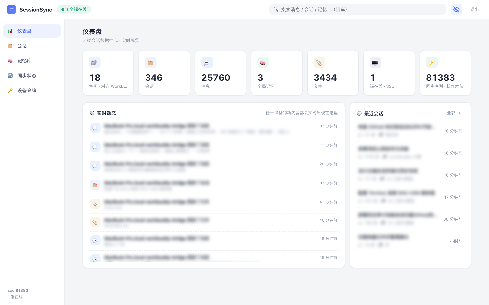
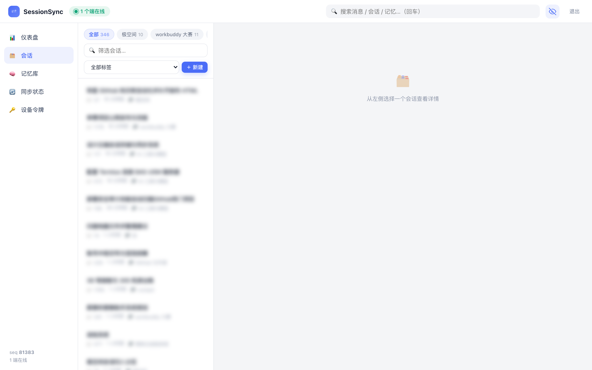
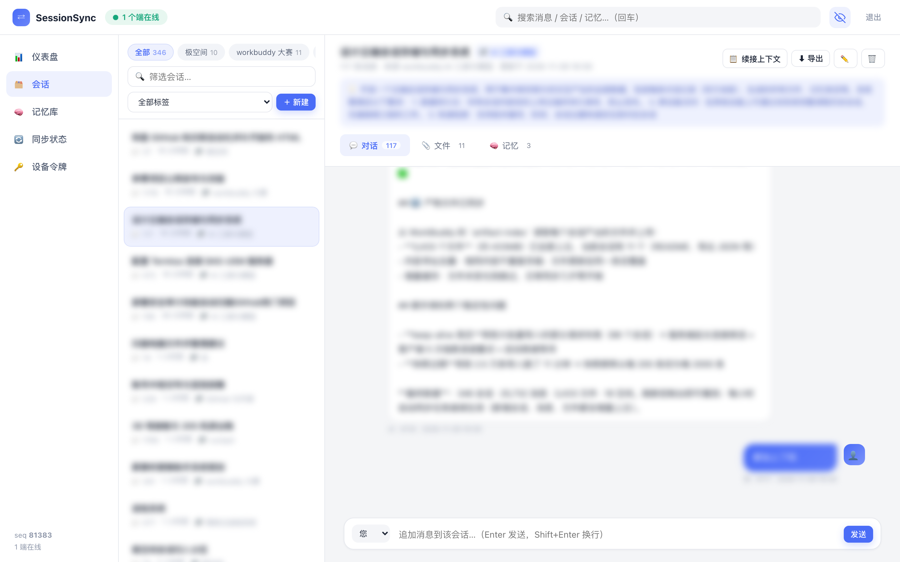
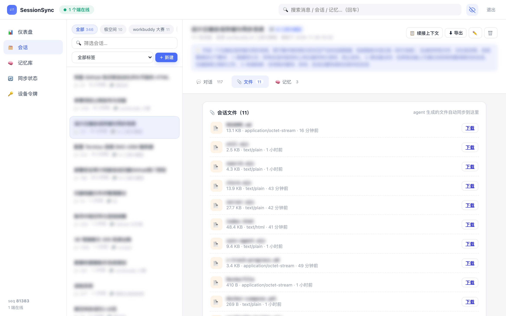

<div align="center">

# WorkBuddy SessionSync

**Self-hosted cloud sync &amp; archive for WorkBuddy conversations — filling the gap the official app leaves open.**

Chat history, generated files and long-term memories, synced to your own server. Search and resume from any device.

[](https://github.com/xmgzxmgz/workbuddy-sessionsync/actions/workflows/ci.yml)
[](LICENSE)
[](https://nodejs.org)
[](#)
[](Dockerfile)

[简体中文](README.md) · [English](README.en.md)



</div>

> **Unofficial project.** Built by the community, not affiliated with WorkBuddy. It only reads your local WorkBuddy data and never uploads it to a third party.

---

## Why this exists

WorkBuddy does not ship cloud sync for conversation history. Your chats live in `~/.workbuddy` on a single machine:

- Reinstall, switch laptops, or delete a workspace — history is gone.
- No way to read or search past sessions from a phone.
- Generated files and memories are scattered across workspaces.
- No full-text search when you need that one sentence from three months ago.
- Moving to a new device means manually copying a wall of context.

**WorkBuddy SessionSync closes that gap.** It streams your local WorkBuddy sessions to a server you own (NAS, VPS, even a Raspberry Pi) and gives you cross-device access, full-text search, one-click resume and artifact archiving.

> Verified at scale: **321 sessions · 25k messages · 3,966 artifacts**; first full import ~3 minutes, incremental sync finishes in seconds.

## What gets synced

| Data | Local source | Processing |
|---|---|---|
| Session metadata | `~/.workbuddy/workbuddy.db` → `sessions` | title, timestamps, status, workspace (space) |
| Messages | `~/.workbuddy/projects/<workspace>/<id>.jsonl` | only `type=message`, strips injected `<system-reminder>`, prefers `<user_query>` |
| Spaces | session `cwd` | grouped by workspace name, mirroring the WorkBuddy sidebar |
| Artifacts | `~/.workbuddy/artifact-index/<id>.json` | uploads files (≤50MB), sha256 content addressing |
| Memories | manual / API | global or session-scoped, shared through the sync stream |

Skipped: tool call payloads, reasoning traces, image blobs — only what a human actually reads and produces.

## How it works

```
WorkBuddy local data (SQLite + JSONL + artifact-index)
        │  ① collect: agent/workbuddy-bridge.mjs
        ▼
normalize (strip injected context, role map, space naming,
           content hash → idempotent op_id)
        │  ② push: POST /api/sync/push
        ▼
SessionSync server (your host)
   ③ append-only oplog with a global monotonic seq   ← source of truth
   ④ in-memory inverted index (CJK bigrams)
   ⑤ snapshots + content-addressed file store
   REST API · SSE stream · search
        │  ⑥ fan-out: SSE broadcast / incremental pull
        ▼
browser console · CLI · other devices
```

1. **Collect** — read the session list from SQLite, parse each JSONL transcript, load artifacts from the index.
2. **Normalize** — clean injected system context, map roles, derive the space name, hash each record.
3. **Push (idempotent)** — every record becomes an op carrying an `op_id` (session = metadata hash, message = text+timestamp hash, file = sha256). The server dedupes by `op_id`, so retries and re-runs are always safe.
4. **Oplog as truth** — ops are appended with a global `seq`; state and indexes are rebuilt by replay. Snapshots only speed up boot.
5. **Index** — CJK bigrams + ASCII words, weighted by field; queries combine keyword × space × tag × time × role.
6. **Fan-out** — new writes are broadcast over SSE; devices can also pull incrementally with `since_seq`.

## Getting started

### 1. Run the server

```bash
git clone https://github.com/xmgzxmgz/workbuddy-sessionsync.git
cd workbuddy-sessionsync
docker compose up -d --build     # port 8787, data in ./data
# or: node server.mjs
```

The first run prints an access token (also written to `data/initial-token.txt`). Pin your own with a `.env` file:

```bash
echo 'ACCESS_TOKEN=your-long-random-token' > .env && docker compose up -d
```

### 2. First full import (on the machine running WorkBuddy)

```bash
mkdir -p ~/.sessionsync
cat > ~/.sessionsync/config.json <<'EOF'
{ "server": "http://your-host:8787", "token": "your-token" }
EOF

node agent/workbuddy-bridge.mjs --verbose
```

### 3. Keep it in sync (pick one)

```bash
node agent/workbuddy-bridge.mjs --watch --interval 300   # resident, every 5 min
launchctl load -w ~/Library/LaunchAgents/com.sessionsync.workbuddy-bridge.plist  # macOS
# or schedule it as a WorkBuddy automation (hourly)
```

Unchanged transcripts are skipped by mtime/size, so routine runs take about a second.

### 4. Use it in the browser

Open `http://your-host:8787` and paste the token (`?token=...` auto-logs-in).

- **Dashboard** — totals plus a live feed of sync activity
- **Sessions** — space chips mirror your WorkBuddy workspaces
- **Tabs** — chat transcript / files / memories per session
- **Search** — keyword × type × space × tag × time
- **Resume** — one click copies a complete context bundle for any assistant
- **Privacy mode** — the eye button blurs titles and messages for safe screenshots

### 5. Back up and upgrade

```bash
./scripts/backup.sh /path/to/data /path/to/backup-disk   # daily hardlink snapshots, keep 14
git pull && docker compose up -d --build
```

Everything lives under `data/` (`oplog.jsonl` + `files/<sha256>`) — copy that directory and you have a full backup.

## Features

- 🗂 Four first-class entities: sessions, messages, memories, files
- 📡 Real-time sync: SSE + incremental pull/push + idempotent `op_id`
- 🔎 CJK-friendly search: `审计框架` matches `安全审计工具的测试框架`
- 🧩 Spaces mirror WorkBuddy workspaces
- 🧠 One-click context bundle for resuming anywhere
- 🕶 Privacy mode for screenshots
- 📎 Artifact archiving with sha256 dedupe
- 🪶 Zero dependencies, single-port HTTP, Docker-friendly
- ✅ CI: 13-step end-to-end smoke test on GitHub Actions

## Screenshots

| Spaces | Chat / files / memories |
|---|---|
|  |  |

| Artifacts | Privacy mode |
|---|---|
|  |  |

## API

`GET /api/status` · `GET /api/spaces` · `GET/POST /api/sessions` · `GET/PATCH/DELETE /api/sessions/:id` · `GET/POST /api/sessions/:id/messages` · `GET /api/sessions/:id/context?full=1` · `GET/POST /api/memories` · `POST /api/files` + `GET /files/:id` · `GET /api/search` · `GET/POST /api/sync/pull|push` · `GET /api/sync/stream` (SSE)

All endpoints except `/` require `Authorization: Bearer <token>`.

## FAQ

**Does my data go to a third party?** No — the server is yours; traffic only flows from your machine to your host.
**Mobile?** Yes, the console is responsive; on narrow screens a back button appears after opening a session.
**Windows?** The bridge is cross-platform; point it at your local `~/.workbuddy` equivalent and schedule it (only macOS auto-install is bundled today).
**Will it corrupt WorkBuddy?** No — the bridge opens the database read-only and never writes to `~/.workbuddy`.

## Roadmap

- [ ] Optional E2E encryption for message bodies
- [ ] PWA / offline cache
- [ ] One-click bridge installers for Windows / Linux
- [ ] Importers for other assistants (Claude, ChatGPT exports)
- [ ] SQLite FTS5 for million-message scale
- [ ] WebDAV / S3 backup targets

## License

[MIT](LICENSE) © 2026 xmgzxmgz
