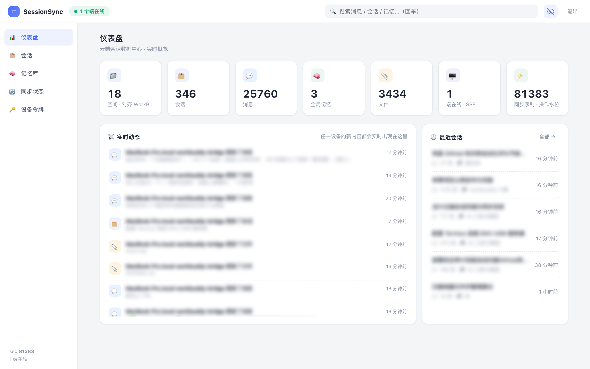
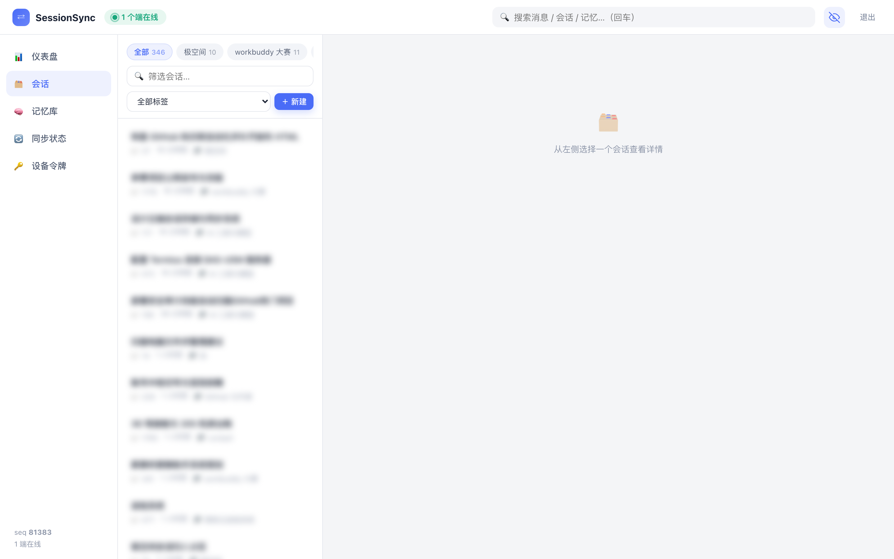
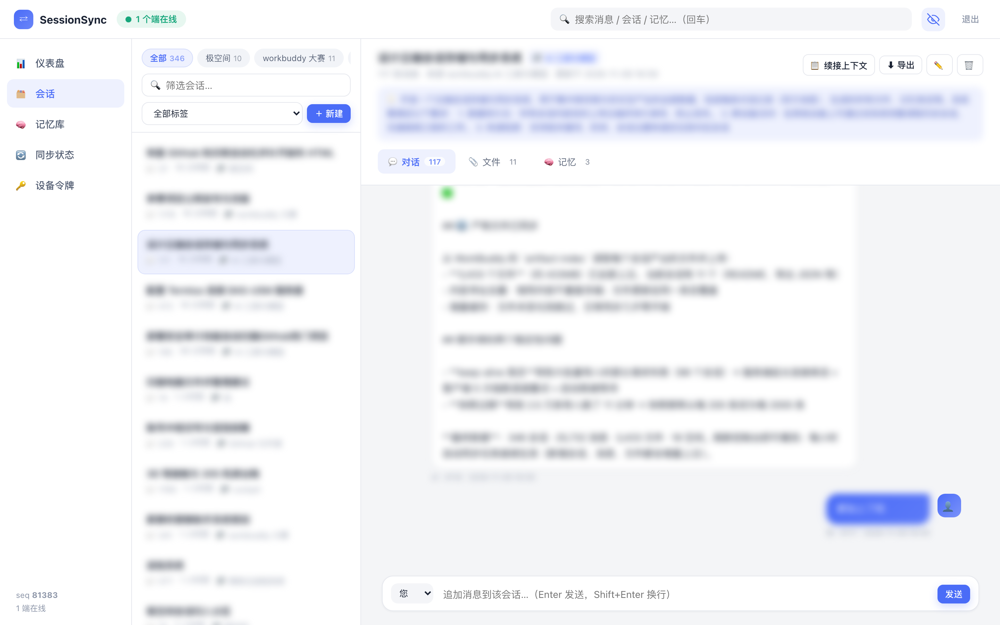
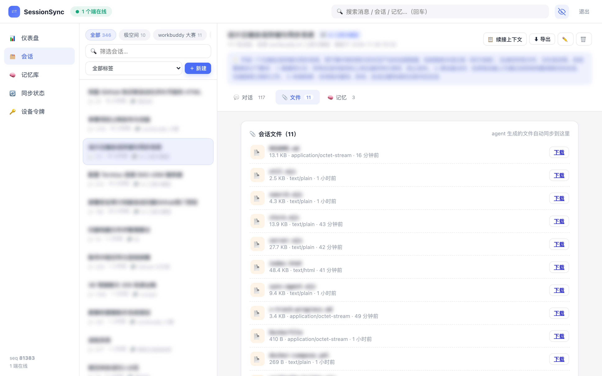

<div align="center">

# WorkBuddy SessionSync

**给 WorkBuddy 补上官方没有的那块：对话记录云端同步与归档**

本机对话 / 生成的文件 / 长期记忆 —— 同步到你自己的服务器，多设备随时检索、随时续接。

[](https://github.com/xmgzxmgz/workbuddy-sessionsync/actions/workflows/ci.yml)
[](LICENSE)
[](https://nodejs.org)
[](#)
[](Dockerfile)

[简体中文](README.md) · [English](README.en.md)



</div>

> **非官方项目**：本项目为社区实现，与 WorkBuddy 官方无关。它只读取你本机的 WorkBuddy 数据，不会向任何第三方上传。

---

## 一、为什么需要它

WorkBuddy 日常很好用，但**官方不提供对话记录的云同步**。这带来几个很实际的麻烦：

- 💾 **对话只活在本机**：`~/.workbuddy` 里的历史，换电脑、重装系统、误删空间就没了
- 📱 **手机看不到历史**：出门在外想翻两周前的方案，只能干瞪眼
- 🔍 **没有全文检索**：想找三个月前那句"报价按 58 万报"，只能一条条翻
- 📎 **产物文件散落各处**：助手生成的脚本、文档、看板散落在各个工作区，没人统一管理
- 🧠 **记忆无法迁移**：换设备后，之前的上下文、约定、偏好全部归零
- 🔁 **无法续接**：想在新设备上接着上次的活干，得手动复制一大段上下文

**WorkBuddy SessionSync 就是来补这个缺口的**：把本机 WorkBuddy 的会话数据，实时同步到你自己的一台服务器（NAS、云主机、树莓派都行），提供跨设备访问、全文检索、一键续接、产物归档。

> 实测规模：**321 个会话 · 2.5 万条消息 · 3,966 个产物文件**，全量首同步约 3 分钟，日常增量同步秒级完成。

## 二、它同步什么

| 数据 | WorkBuddy 本地来源 | 处理方式 |
|---|---|---|
| 会话元数据 | `~/.workbuddy/workbuddy.db` → `sessions` 表 | 标题、时间、状态、工作区（空间） |
| 消息正文 | `~/.workbuddy/projects/<工作区>/<会话ID>.jsonl` | 只取 `type=message` 的双方消息，剥离注入的 `<system-reminder>`，优先提取 `<user_query>` |
| 空间 | 会话的 `cwd` | 按目录名归组（与 WorkBuddy 侧边栏空间一致） |
| 产物文件 | `~/.workbuddy/artifact-index/<会话ID>.json` | 上传文件内容（≤50MB），sha256 内容寻址、自动去重 |
| 记忆 | 手动添加 / API | 全局或会话级，随同步流共享 |

**不会同步**：工具调用的中间结果、推理过程、图片二进制引用——只保留人和助手实际看到的文字与产出。

## 三、实现流程（数据怎么流动）

```
┌──────────────────────┐
│  WorkBuddy 本机数据    │  SQLite（会话元数据）
│  ~/.workbuddy         │  JSONL（逐条消息）
│                      │  artifact-index（产物清单）
└──────────┬───────────┘
           │ ① 采集：agent/workbuddy-bridge.mjs
           ▼
┌──────────────────────┐
│  规范化               │  剥离系统注入 / 角色映射 / 空间命名
│                      │  内容哈希 → 幂等 op_id
└──────────┬───────────┘
           │ ② 入云：POST /api/sync/push
           ▼
┌──────────────────────────────────┐
│  SessionSync 服务端（你的服务器）    │
│                                  │
│  ③ 追加式 oplog（全局单调 seq）      │ ← 唯一事实来源
│  ④ 内存倒排索引（CJK 二元词组）       │
│  ⑤ 快照 + 内容寻址文件库             │
│                                  │
│  REST API · SSE 实时流 · 检索       │
└──────────┬───────────────────────┘
           │ ⑥ 分发：SSE 广播 / 增量 pull
           ▼
   浏览器控制台 · CLI · 其他设备
```

拆开讲六步：

1. **采集**：桥接脚本读 SQLite 拿会话清单，逐个解析对应 JSONL；同一会话的产物清单来自 artifact-index。
2. **规范化**：清洗用户消息里注入的系统上下文；角色统一为 user/assistant/system/tool；工作区目录名映射为「空间」；为每条消息计算内容哈希。
3. **入云（幂等）**：每条数据变成一条操作（op），携带 `op_id`（会话=元数据哈希，消息=文本+时间戳哈希，文件=内容 sha256）。服务端按 `op_id` 去重，重跑、断点续传、多设备重复上报都安全。
4. **日志即真相**：服务端把操作追加到 `oplog.jsonl` 并分配全局递增 `seq`；内存状态与索引由日志重放得出；`snapshot.json` 只用于加速重启。
5. **索引**：中文按二元词组（bigram）、英文按词切分建倒排索引，标题/空间权重高于正文，支持关键词 × 空间 × 标签 × 时间 × 角色组合过滤。
6. **分发**：任意设备写入后，服务端通过 SSE 实时广播；其他设备也可用 `since_seq` 做增量拉取，断网恢复后自动补齐。

## 四、操作流程（从零到用起来）

### 第 0 步：准备

- 一台常开的机器（NAS / 云主机 / 树莓派），装有 Docker 或 Node.js ≥ 18
- 本机（跑 WorkBuddy 的电脑）能访问这台机器（内网 / Tailscale 均可）

### 第 1 步：部署服务端

```bash
git clone https://github.com/xmgzxmgz/workbuddy-sessionsync.git
cd workbuddy-sessionsync

# 方式 A：Docker（推荐，NAS 上就这么跑）
docker compose up -d --build      # 默认 8787 端口，数据在 ./data

# 方式 B：直接跑
node server.mjs                    # 首次启动会打印访问令牌
```

令牌保存在 `data/initial-token.txt`。想固定令牌，就在同目录写 `.env`：

```bash
echo 'ACCESS_TOKEN=你的长随机串' > .env && docker compose up -d
```

### 第 2 步：首次全量导入

在跑 WorkBuddy 的电脑上（需要 Node ≥ 18）：

```bash
# 配置服务器地址与令牌（只需一次）
mkdir -p ~/.sessionsync
cat > ~/.sessionsync/config.json <<'EOF'
{ "server": "http://你的服务器:8787", "token": "你的令牌" }
EOF

# 全量导入（幂等，可重复执行）
node agent/workbuddy-bridge.mjs --verbose
```

预期输出：

```
  ✓ 设计云端会话存储与同步系统（117 条消息，11 个文件）
  ✓ 参赛项目公网发布与改版（1156 条消息）
  ...
✅ 同步完成：扫描 346 个会话文件，处理 346 个会话
   新应用 2578 条 · 已存在跳过 0 条 · 错误 0 条
   文件上传 3419 个 · 跳过 0 个
```

### 第 3 步：配置自动同步（三选一）

```bash
# A. 常驻模式：每 5 分钟增量一次
node agent/workbuddy-bridge.mjs --watch --interval 300

# B. macOS LaunchAgent：登录后每 5 分钟自动跑
launchctl load -w ~/Library/LaunchAgents/com.sessionsync.workbuddy-bridge.plist

# C. WorkBuddy 自动化：建一个每小时执行 bridge 的任务（无需保持终端）
```

桥接会记录每个文件的 mtime/size，未变化的会话直接跳过——日常一次增量通常在 1 秒内完成。

### 第 4 步：浏览器使用

打开 `http://你的服务器:8787`，输入令牌（或直接访问 `?token=xxx` 自动登录）。

| 想看什么 | 怎么操作 |
|---|---|
| 总览 | **仪表盘**：会话/消息/文件/在线端统计，右侧是实时同步动态 |
| 按工作区找 | **会话** 页顶部**空间胶囊**（如"AI 工具与模型""极空间"），点一下只看该空间 |
| 读某次对话 | 点会话 → **对话** 页签（左右气泡）；**文件** 页签看产物并下载；**记忆** 页签看关联记忆 |
| 搜历史 | 顶栏搜索框回车，或检索页组合筛选：关键词 × 类型 × 空间 × 标签 × 时间 |
| 去新设备续接 | 会话右上角 **📋 续接上下文**，一键复制完整上下文，粘贴到任意助手继续 |
| 截图分享 | 右上角 **👁 小眼睛** 打开隐私模式，标题与正文全部模糊，悬停本地可见 |
| 多设备状态 | **同步状态** 页：在线端名单、各设备同步水位、落后多少条 |

### 第 5 步：备份与升级

```bash
# 每日快照备份（异盘、硬链接增量、保留 14 份）
./scripts/backup.sh /path/to/data /path/to/backup-disk

# 升级
git pull && docker compose up -d --build
```

数据全在 `data/` 目录：`oplog.jsonl`（事实来源）+ `files/<sha256>`（文件内容）。**复制这个目录就是完整备份。**

## 五、功能一览

- 🗂 **四类实体统一归档**：会话、消息、记忆、文件
- 📡 **实时同步**：SSE 广播 + 增量 pull/push + `op_id` 幂等去重
- 🔎 **中文友好检索**：CJK 二元词组倒排索引，`审计框架` 能命中 `安全审计工具的测试框架`
- 🧩 **空间视图**：与 WorkBuddy 侧边栏工作区一一对应
- 🧠 **一键续接**：生成结构化上下文包，任意设备粘贴即续
- 🕶 **隐私模式**：一键模糊正文，截图可安全分享
- 📎 **产物归档**：助手生成的文件自动上云，sha256 去重
- 🪶 **零依赖**：纯 Node.js 标准库，单端口 HTTP 服务，Docker 一键部署
- ✅ **CI 保障**：GitHub Actions 跑 13 步端到端冒烟测试

## 六、界面

| 空间视图 | 对话 / 文件 / 记忆 三页签 |
|---|---|
|  |  |

| 产物文件 | 隐私模式（截图前开启） |
|---|---|
|  |  |

## 七、架构与数据模型

| 实体 | 字段 |
|---|---|
| `session` | 标题、**空间**、标签、摘要、来源、时间 |
| `message` | 会话、角色、正文、时间、元信息 |
| `memory` | 全局 / 会话级、键、内容 |
| `file` | 名称、MIME、大小、sha256（内容寻址，自动去重） |

设计取舍：

- **oplog 为唯一事实来源**：写入即追加，删除是墓碑，天然可重放、可审计、可备份
- **冲突处理**：服务端统一排序，实体级后写胜出；追加类操作天然可交换
- **文件去重**：按 sha256 存储，同一产物在十个会话里也只占一份
- **规模**：内存索引在几万条消息量级毫无压力；百万级需换 SQLite FTS5（见路线图）

更详细的中文设计文档：[docs/DESIGN.zh-CN.md](docs/DESIGN.zh-CN.md)

## 八、API 一览

| 方法 | 路径 | 说明 |
|---|---|---|
| GET | `/api/status` | 服务器状态与在线端 |
| GET | `/api/spaces` | 空间聚合 |
| GET/POST | `/api/sessions` | 列表（q / space / tag / 时间）/ 新建 |
| GET/PATCH/DELETE | `/api/sessions/:id` | 读取 / 更新 / 级联删除 |
| GET/POST | `/api/sessions/:id/messages` | 消息列表 / 追加 |
| GET | `/api/sessions/:id/context?full=1` | 续接上下文包 |
| GET/POST | `/api/memories` | 记忆条目 |
| POST `/api/files` · GET `/files/:id` | 上传 / 下载 |
| GET | `/api/search` | 关键词 × 空间 × 标签 × 时间 × 角色 |
| GET/POST | `/api/sync/pull` `/api/sync/push` | 增量同步 |
| GET | `/api/sync/stream` | SSE 实时流（在线端 + 操作） |

除首页外全部接口需要 `Authorization: Bearer <token>`。

## 九、常见问题

**Q：数据会被上传到第三方吗？**
不会。服务端是你自己的机器，数据只在「本机 → 你的服务器」之间流动。

**Q：手机上能用吗？**
能。浏览器打开同一地址即可；小屏会隐藏列表，点会话后左上角有「← 返回」。

**Q：Windows 上也能自动同步吗？**
桥接脚本本身跨平台（Node ≥ 18），Windows 需要把 `~/.workbuddy` 路径改成本机路径并配一个计划任务；目前仓库里的自动安装脚本只适配 macOS。

**Q：换电脑后怎么继续？**
新电脑先 `git clone` 部署（或直接连已有服务器），浏览器打开、找到会话、点「续接上下文」，粘贴到 WorkBuddy 即可接着干。

**Q：令牌太短有风险吗？**
内网/Tailscale 使用无碍；如要公网访问，请务必前置 HTTPS 反代并换成长随机令牌。

**Q：会不会把官方数据弄坏？**
桥接是**只读**的：只读 SQLite 与 JSONL，不写入 `~/.workbuddy`。

## 十、路线图

- [ ] 消息正文端到端加密（可选）
- [ ] PWA / 离线缓存
- [ ] Windows / Linux 一键桥接安装脚本
- [ ] 更多助手导入器（Claude、ChatGPT 导出）
- [ ] 百万级消息切换 SQLite FTS5
- [ ] WebDAV / S3 备份目标

## 十一、贡献与许可

欢迎 Issue 与 PR。请保持零依赖（除非有充分理由），提交前跑：

```bash
for f in server.mjs lib/*.mjs agent/*.mjs test/*.mjs; do node --check "$f"; done
node test/smoke.mjs
```

[MIT](LICENSE) © 2026 xmgzxmgz
