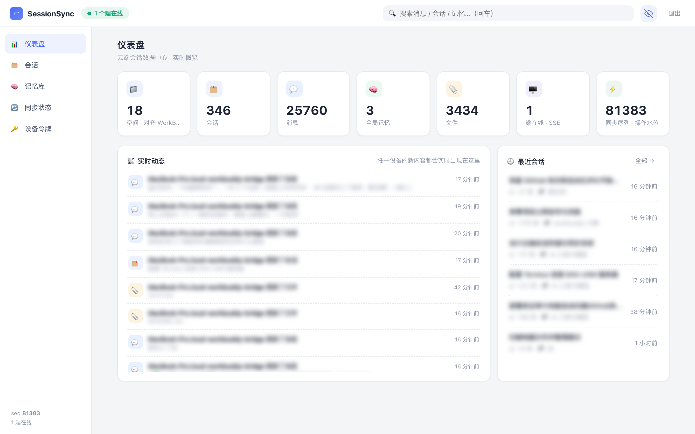
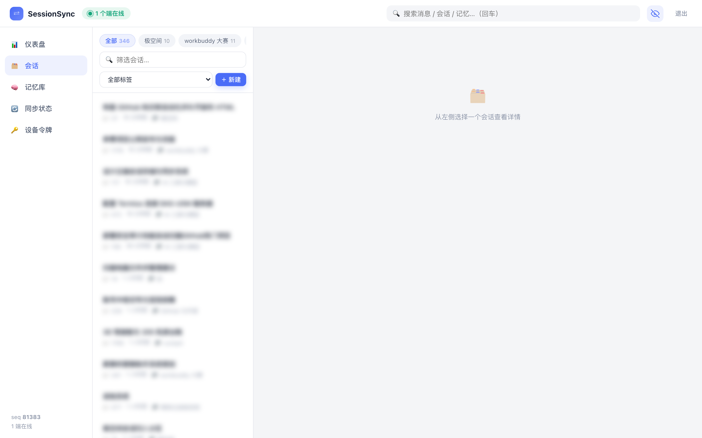
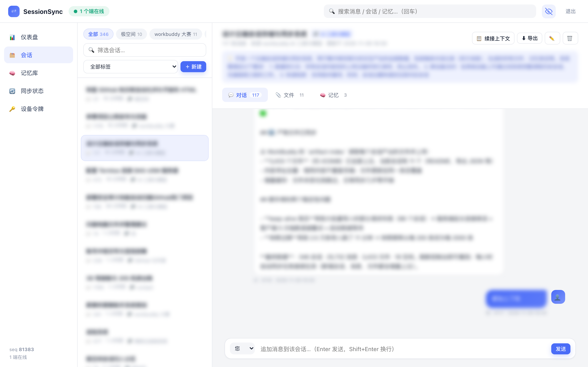
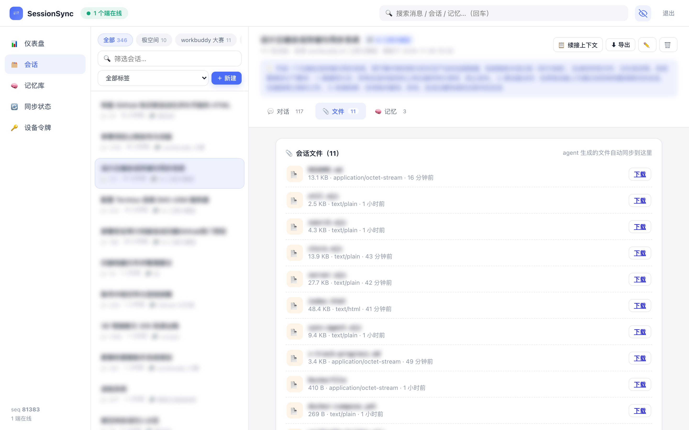

<div align="center">

# WorkBuddy SessionSync

**自托管的 AI 会话归档与实时同步系统**
对话、生成的文件、长期记忆 —— 一个私有云，所有设备可见。

[](https://github.com/xmgzxmgz/workbuddy-sessionsync/actions/workflows/ci.yml)
[](LICENSE)
[](https://nodejs.org)
[](#)

[English](README.md) · [简体中文](README.zh-CN.md)



</div>

---

## 为什么

AI 助手正在承载越来越多真实工作，但对话记录往往锁在单一应用、单台设备里——换工具、重装系统就没了。**SessionSync 把聊天历史变成可迁移、可检索、可自托管的个人数据集。**

- 🗂 **集中归档**：双方每条消息、每个生成的文件、每条记忆条目
- 📡 **实时同步**：任意设备写入，其他设备秒级可见（SSE）
- 🔎 **中文友好检索**：CJK 二元词组倒排索引，关键词 × 空间 × 标签 × 时间 × 角色组合过滤
- 🧠 **无缝续接**：一键生成完整上下文包，粘贴到任意助手继续
- 🕶 **隐私模式**：右上角小眼睛一键模糊标题与正文，截图可安全分享
- 🪶 **零依赖**：纯 Node.js 标准库，数据就是磁盘上的 JSONL + 文件
- 🧩 **空间对齐**：按工作区分组会话，与 WorkBuddy 侧边栏空间一致

## 界面

| 空间视图 | 对话页签（对话/文件/记忆） |
|---|---|
|  |  |

| 产物文件 | 隐私模式 |
|---|---|
|  |  |

## 架构

```
设备 / 浏览器 / CLI
        │  HTTPS + Bearer Token
        ▼
┌───────────────────────────┐
│  SessionSync server       │
│  REST · SSE · 中文检索     │
│        │                  │
│  追加式 oplog（全局 seq）  │
│  快照 + 内容寻址文件库     │
└───────────────────────────┘
```

**操作日志（oplog）是唯一事实来源**：每次写入都成为带全局递增 `seq` 的不可变操作，内存状态与倒排索引由日志重放得出，快照只用于加速启动。

- **幂等同步**：客户端用固定 `op_id` 重试，服务端自动去重
- **增量拉取**：`GET /api/sync/pull?since_seq=N`
- **删除可同步**：墓碑随日志传播
- **备份简单**：复制 `data/` 即可

### 数据模型

| 实体 | 字段 |
|---|---|
| `session` | 标题、**空间**、标签、摘要、来源、时间 |
| `message` | 会话、角色（user/assistant/system/tool）、正文、时间、元信息 |
| `memory` | 全局 / 会话级、键、内容 |
| `file` | 名称、MIME、大小、sha256（内容寻址，自动去重） |

## 快速开始

```bash
git clone https://github.com/xmgzxmgz/workbuddy-sessionsync.git
cd workbuddy-sessionsync
node server.mjs            # → http://localhost:8787
```

首次启动会生成访问令牌并打印（同时写入 `data/initial-token.txt`）。

```bash
PORT=8787 DATA_DIR=./data ACCESS_TOKEN=my-secret node server.mjs
```

### Docker

```bash
docker compose up -d --build   # 端口 8787，数据保存在 ./data
```

### NAS / 家用服务器

群晖、极空间、树莓派等能跑 Docker 或 Node.js 的设备均可。公网暴露时请前置 HTTPS 反代，并使用长随机令牌。

## 接入数据

### Web 控制台
打开地址、粘贴令牌，其余全部可视化操作。

### 命令行同步代理

```bash
node agent/sync-agent.mjs push   --server http://host:8787 --token <t> --file session.json
node agent/sync-agent.mjs pull   --server http://host:8787 --token <t> --out ./mirror --with-files
node agent/sync-agent.mjs status --server http://host:8787 --token <t>
```

### WorkBuddy 桥接（可选，macOS）

自动导入本机 WorkBuddy 历史：会话、消息、**空间**、以及助手生成的每一个产物文件。

```bash
node agent/workbuddy-bridge.mjs            # 增量同步一次
node agent/workbuddy-bridge.mjs --watch    # 常驻，每 5 分钟
```

读取 `~/.workbuddy/workbuddy.db` 与 `~/.workbuddy/projects/*.jsonl`，剥离注入的系统上下文，全部操作幂等。

## API 一览

| 方法 | 路径 | 说明 |
|---|---|---|
| GET | `/api/status` | 服务器状态与在线端 |
| GET | `/api/spaces` | 空间聚合 |
| GET/POST | `/api/sessions` | 列表（q / space / tag / 时间）/ 新建 |
| GET/PATCH/DELETE | `/api/sessions/:id` | 读取 / 更新 / 级联删除 |
| GET/POST | `/api/sessions/:id/messages` | 消息列表 / 追加 |
| GET | `/api/sessions/:id/context?full=1` | 续接上下文包 |
| GET/POST | `/api/memories` | 记忆条目 |
| POST `/api/files` · GET `/files/:id` | 上传 / 下载 |
| GET | `/api/search` | 关键词 × 空间 × 标签 × 时间 × 角色 |
| GET/POST | `/api/sync/pull` `/api/sync/push` | 增量同步 |
| GET | `/api/sync/stream` | SSE 实时流（在线端 + 操作） |

除首页外全部接口需要 `Authorization: Bearer <token>`。

## 设计细节

- **中文分词**：ASCII 按词、CJK 按二元词组；打分以覆盖率为主，`审计框架` 能命中 `安全审计工具的测试框架`
- **冲突处理**：服务端统一排序，实体级后写胜出；追加天然可交换
- **文件去重**：按 sha256 存储，同一产物在十个会话里也只占一份
- **隐私模式**：纯 CSS `filter: blur`，不修改任何存储数据，悬停本地可见

更多设计说明见 [docs/DESIGN.zh-CN.md](docs/DESIGN.zh-CN.md)。

## 路线图

- [ ] 消息正文端到端加密（可选）
- [ ] PWA / 离线缓存
- [ ] 更多助手导入器（Claude、ChatGPT 导出）
- [ ] WebDAV / S3 备份

## 贡献

欢迎 Issue 与 PR。除非有充分理由，请保持零依赖；提交前跑一遍 `node --check`。

## 许可证

[MIT](LICENSE)
